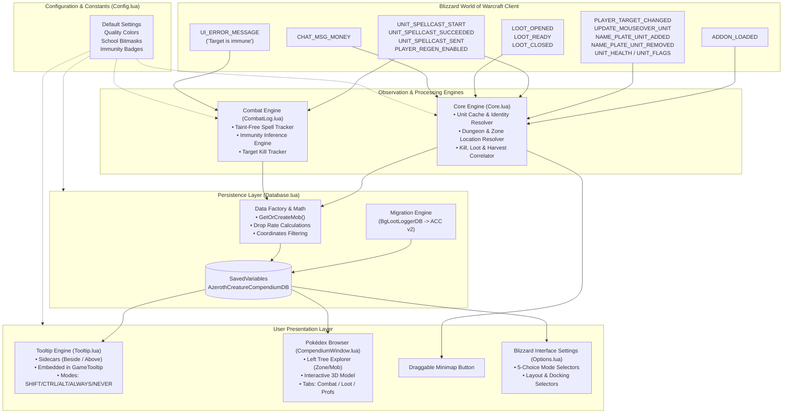
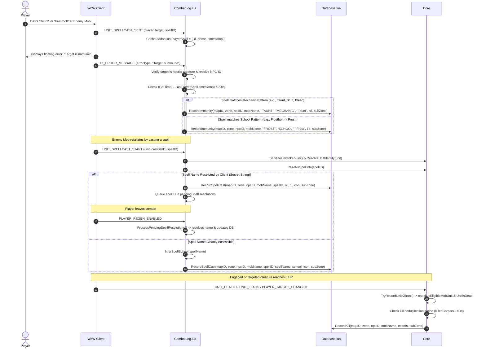
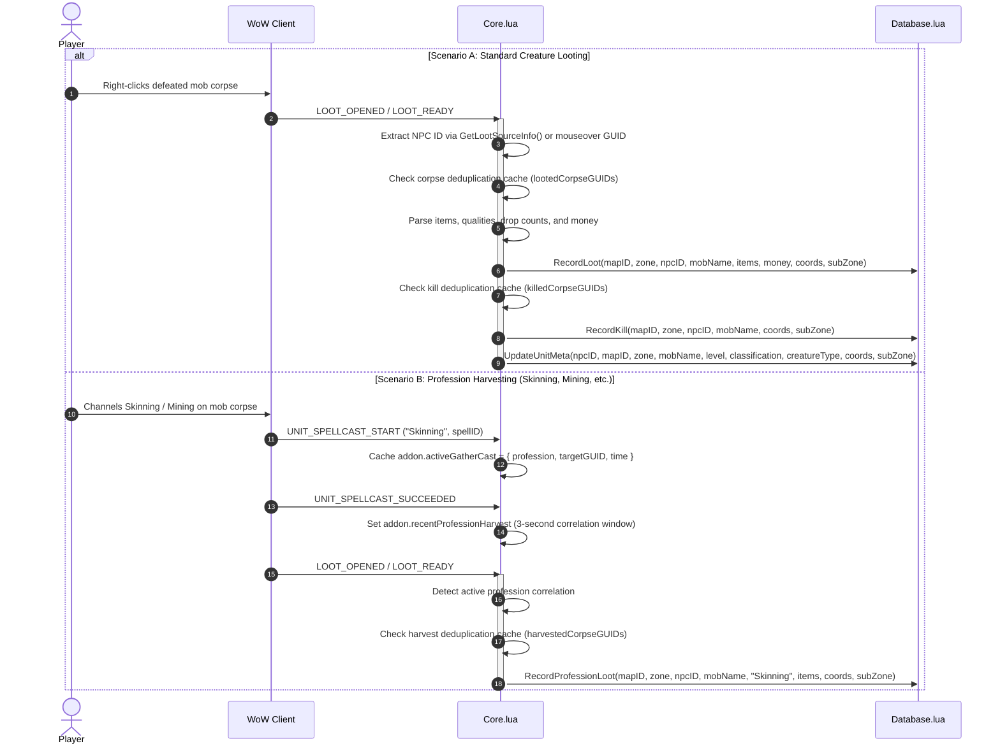
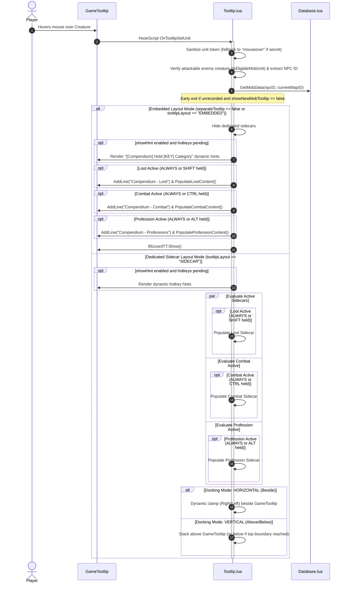

# Azeroth Creature Compendium - System Architecture

> **Document Version:** 1.0.1  
> **Target Environment:** World of Warcraft Classic & Forever Beta (Interface: 11506, 11505, 11504, 11503, 11404, 16001)  
> **Status:** Active / Production  
> **Audience:** Senior Architects, Junior Developers, Executives, and AI Coding Agents

---

## 📑 Table of Contents
1. [Executive Summary](#-executive-summary)
2. [High-Level System Architecture](#-high-level-system-architecture)
3. [Component Breakdown & File Registry](#-component-breakdown--file-registry)
4. [Core Execution Pipelines (Sequence Diagrams)](#-core-execution-pipelines-sequence-diagrams)
   - [Addon Lifecycle & Initialization](#1-addon-lifecycle--initialization)
   - [Combat & Taint-Free Immunity Detection](#2-combat--taint-free-immunity-detection)
   - [Loot & Profession Gathering Pipeline](#3-loot--profession-gathering-pipeline)
   - [Sidecar Tooltip Multi-Docking Engine](#4-sidecar-tooltip-multi-docking-engine)
5. [Database Architecture & Schema Specification](#-database-architecture--schema-specification)
6. [Key Engineering & Design Decisions](#-key-engineering--design-decisions)
7. [Guidelines for Contributors & AI Agents](#-guidelines-for-contributors--ai-agents)

---

## 🏛️ Executive Summary

The **Azeroth Creature Compendium (ACC)** is a production-grade World of Warcraft Classic addon engineered to operate as a local, fully autonomous in-game Pokédex. It dynamically discovers, catalogs, analyzes, and indexes creature behavior, drop tables, profession gathers, auto-attack metrics, and combat immunities through non-invasive observation of native game events.

### Architectural Tenets
- **Zero-Taint Integrity:** Operates without hooking protected action buttons or subscribing to restricted combat log streams (`COMBAT_LOG_EVENT_UNFILTERED`), eliminating combat action blocked errors (Lua taint).
- **Decoupled Event-Driven Core:** Strict separation between event listeners (Inference Engines), data persistence (Storage Layer), and presentation (Sidecar Tooltips, Pokédex Window, Options Panel).
- **Single Source of Truth:** Centralized database (`AzerothCreatureCompendiumDB`) managed through authoritative mutation methods with full backward compatibility and automated schema migration.
- **Low Memory & CPU Footprint:** Bounded cache ring buffers (capped at 400 entries) and lightweight on-demand calculations prevent frame drops and memory leaks during multi-hour raid and farming sessions.

---

## 📐 High-Level System Architecture

The following diagram illustrates the flow of data from native World of Warcraft C-engine events through our observation layer, down into persistent storage, and up to the player-facing presentation frames.



---

## 📦 Component Breakdown & File Registry

The addon is modularized across seven specialized Lua files plus the TOC manifest. Load order is strictly sequential as defined in [AzerothCreatureCompendium.toc](../AzerothCreatureCompendium.toc).

| Execution Order | File | Responsibility | Primary APIs / Exports |
| :--- | :--- | :--- | :--- |
| **1** | [Config.lua](../Config.lua) | Global namespace initialization, dynamic TOC version resolution, constant definitions, color matrices, default preferences, secret value detection/sanitization, and slash command registries. | `addon:IsSecretValue()`, `addon:SafeString()`, `addon:SafeNumber()`, `addon:SafeBool()`, `addon.DEFAULT_SETTINGS`, `addon.QUALITY_HEX`, `addon.SCHOOL_MASKS`, `addon.IMMUNITY_COLORS` |
| **2** | [Database.lua](../Database.lua) | State management, SavedVariables lifecycle, schema normalization, legacy DB and Unknown Zone auto-migration, drop-rate math, query helpers, rank calculations, research rank badge icon mappings, subzone tracking, secret value sanitization, on-demand deferred spell resolution, and demo data sanitization. | `addon:InitDatabase()`, `addon:GetOrCreateMob()`, `addon:RecordLoot()`, `addon:RecordProfessionLoot()`, `addon:RecordSpellCast()`, `addon:RecordImmunity()`, `addon:RecordSubZone()`, `addon:GetMobSubZones()`, `addon:FormatMobLocationString()`, `addon:GetMobData()`, `addon:GetMobResearchRank()` |
| **3** | [CombatLog.lua](../CombatLog.lua) | Taint-free combat discovery engine. Observes spellcasts, deferred out-of-combat spell resolution, and correlates error notifications to detect school/mechanic immunities without accessing restricted combat logs. | `InferSpellSchool()`, `MatchMechanicByName()`, `addon:ProcessPendingSpellResolutions()`, `AzerothCompendiumCombatListenerFrame` |
| **4** | [Core.lua](../Core.lua) | Master event listener, creature unit inspector, secret unit token sanitizer, pre-combat unit identity cache, dungeon/instance location resolver, hostile/attackable creature eligibility guard, unit death and corpse GUID kill tracking, profession harvest correlation, coin transaction parser, and safe spell info resolver. | `addon:SanitizeUnitToken()`, `addon:ResolveUnitIdentity()`, `addon:TryRecordUnitKill()`, `addon:MarkMobEngaged()`, `addon:ResolveSpellInfo()`, `addon:GetSpellName()`, `addon:ProcessLoot()`, `addon:CacheUnit()`, `addon:IsEligibleMobUnit()`, `addon:IdentifyGatheringSpell()`, `addon:GetPlayerLocation()`, `addon:GetNPCIDFromGUID()` |
| **5** | [Tooltip.lua](../Tooltip.lua) | Dual tooltip layout engine: Dedicated Tri-sidecars (with dynamic Beside or Above/Below screen docking, and Main Tooltip vs Mouse Cursor anchoring) or single merged `GameTooltip` embedding with live modifier detection (`SHIFT`/`CTRL`/`ALT`/`ALWAYS`/`NEVER`), secret unit token fallback to `"mouseover"`, hostile creature filtering, and toggleable first mob encounter discovery placeholders. | `addon:OnTooltipSetUnit()`, `addon:FormatCoinString()`, `addon:UpdateCompanionTooltips()`, `addon:IsEmbeddedLayout()`, `addon:GetTooltipHintText()`, `AzerothCompendiumLootTooltip`, `AzerothCompendiumCombatTooltip`, `AzerothCompendiumProfessionTooltip` |
| **6** | [CompendiumWindow.lua](../CompendiumWindow.lua) | Two-pane Pokédex browser (`/acc`). Features live search (by creature, zone, subzone, item, or spell), collapsible Zone tree (with hover tooltips for Bestiary Progression ranks and badge icons), 3D interactive model rendering with mouse drag rotation, tabbed metadata cards, Bestiary Progression Rank display with Blizzard medal/portrait badges, creature sub-location display ("Found in:"), and `LibDBIcon-1.0` / `LibDataBroker-1.1` compatible minimap button. | `addon:CreateCompendiumWindow()`, `addon:ToggleCompendiumWindow()`, `addon:CreateMinimapButton()`, `addon:RegisterDataBrokerLauncher()`, `addon:SetMinimapButtonShown()` |
| **7** | [Options.lua](../Options.lua) | Blizzard Interface Options integration (`Settings.RegisterCanvasLayoutCategory`), 5-mode activation button selectors (`SHIFT`, `CTRL`, `ALT`, `ALWAYS`, `NEVER`), layout mode buttons (`SIDECAR` vs `EMBEDDED`), anchor point buttons (`BLIZZARD` vs `CURSOR`), sidecar docking selectors (`HORIZONTAL` vs `VERTICAL`), and feature checkboxes. | `addon:RefreshOptionsHotkeys()`, `addon:RefreshOptionsLayout()`, `addon:OpenOptions()` |

### Packaging & Release Manifests

| File | Purpose | Consumers |
| :--- | :--- | :--- |
| [AzerothCreatureCompendium.toc](../AzerothCreatureCompendium.toc) | Blizzard addon manifest defining load order, SavedVariables, interface versions, and metadata. | World of Warcraft Client, BigWigs Packager |
| [.pkgmeta](../.pkgmeta) | Packaging configuration: specifies zip ignore patterns and binds `manual-changelog` to `CHANGELOG.md`. | BigWigs Packager (`release.sh`) |
| [CHANGELOG.md](../CHANGELOG.md) | Single source of truth for player-centric release notes. Consumed by BigWigs Packager to publish clean notes on CurseForge. | CurseForge, GitHub Releases, End Users |
| [.luacheckrc](../.luacheckrc) | Static analysis configuration for LuaCheck defining WoW Classic globals and code quality rules. | GitHub Actions CI (`lint.yml`), `lint.ps1`, Developers |
| [lint.ps1](../lint.ps1) | Local Windows PowerShell runner that executes or auto-downloads LuaCheck and generates audit reports. | Developers, AI Agents |
| [deploy.ps1](../deploy.ps1) | Local deployment runner that enforces `lint.ps1` (`luacheck`) as a mandatory pre-deploy gate before copying runtime addon files into the local WoW AddOns directory. | Developers, AI Agents |
| [DEPLOYMENT_PIPELINE.md](../DEPLOYMENT_PIPELINE.md) | End-to-end visual sequence documentation for the GitHub Actions -> BigWigs Packager -> CurseForge CDN release pipeline. | Developers, Release Engineers |
| [.github/workflows/lint.yml](../.github/workflows/lint.yml) | Continuous Integration workflow running `lunarmodules/luacheck@v1` on pushes and PRs. | GitHub Actions CI |

---

## 🔄 Core Execution Pipelines (Sequence Diagrams)

### 1. Addon Lifecycle & Initialization

When the game client loads the addon files, the following boot sequence guarantees backward compatibility, defaults merging, and state integrity before any player interaction.

```mermaid
sequenceDiagram
    autonumber
    participant Client as WoW Client
    participant Core as Core.lua
    participant DB as Database.lua

    Client->>Core: Fire ADDON_LOADED (AzerothCreatureCompendium)
    Core->>DB: addon:InitDatabase()
    activate DB
    DB->>DB: Check AzerothCreatureCompendiumDB (SavedVariable)
    DB->>DB: Merge addon.DEFAULT_SETTINGS into db.settings
    alt Legacy BgLootLoggerDB Exists
        DB->>DB: Migrate legacy zones & mobs to v2 structure
        DB->>DB: Migrate legacy keybinding preferences
        DB->>DB: Keep BgLootLoggerDB pointer synchronized
    end
    DB->>DB: Prune empty non-rare mob stubs & legacy demo data
    deactivate DB
    Core->>Client: Print welcome message with configured modifier hotkeys
```



---

### 2. Combat & Taint-Free Immunity Detection

Rather than listening to `COMBAT_LOG_EVENT_UNFILTERED` (which triggers Blizzard UI taint restrictions during combat), the compendium uses a **two-phase correlation engine**:
1. When the player casts an offensive spell, the spell ID and name are cached.
2. If the client fires `UI_ERROR_MESSAGE` with "Target is immune", the engine correlates the error message with the cached spell to record either a **School Immunity** (Fire, Frost, Nature, etc.) or a **Mechanic Immunity** (Taunt, Stun, Bleed, etc.).



---

### 3. Loot & Profession Gathering Pipeline

The compendium differentiates standard mob corpse looting from secondary harvesting professions (Skinning, Mining, Herbalism, Engineering) by correlating gathering cast completions with subsequent loot window events.



---

### 4. Dual Tooltip Layout & Docking Engine

When the player hovers over a creature in the 3D world or unit frame, the compendium dynamically evaluates the player's configured layout (`SIDECAR` vs `EMBEDDED`) and activation modes (`SHIFT`, `CTRL`, `ALT`, `ALWAYS`, `NEVER`).



---

## 🗄️ Database Architecture & Schema Specification

All persistent data is consolidated into a single SavedVariable dictionary: `AzerothCreatureCompendiumDB`.

### Entity Relationship Model

```text
AzerothCreatureCompendiumDB
├── version: number (e.g. 2)
├── settings: table
│     ├── modifierKeyLoot: "SHIFT" | "CTRL" | "ALT" | "ALWAYS" | "NEVER"
│     ├── modifierKeyCombat: "SHIFT" | "CTRL" | "ALT" | "ALWAYS" | "NEVER"
│     ├── modifierKeyProfession: "SHIFT" | "CTRL" | "ALT" | "ALWAYS" | "NEVER"
│     ├── tooltipLayout: "SIDECAR" | "EMBEDDED"
│     ├── tooltipAnchor: "BLIZZARD" | "CURSOR"
│     ├── sidecarAnchor: "HORIZONTAL" | "VERTICAL"
│     ├── separateTooltip: boolean (legacy alias)
│     ├── maxItems: number
│     ├── maxSpells: number
│     ├── minQuality: number
│     ├── showMoney: boolean
│     ├── showHint: boolean
│     ├── showNewMobTooltip: boolean
│     ├── showSample: boolean
│     ├── showMinimap: boolean
│     ├── trackCombat: boolean
│     └── trackImmunities: boolean
├── npcToZones: map<npcID, map<mapID, true>> (Inverted index for O(1) cross-zone lookups)
└── zones: map<mapID, ZoneObject>
      └── [mapID]:
            ├── id: number (Blizzard UiMapID, or 100000 + InstanceID for dungeons/raids)
            ├── name: string (e.g. "Dun Morogh" or "The Deadmines")
            └── mobs: map<npcID, MobObject>
                  └── [npcID]:
                        ├── npcID: number
                        ├── name: string
                        ├── classification: "normal" | "rare" | "elite" | "rareelite" | "worldboss"
                        ├── creatureType: string (e.g. "Beast", "Humanoid", "Undead")
                        ├── minLevel: number
                        ├── maxLevel: number
                        ├── kills: number
                        ├── encounters: number
                        ├── firstSeen: timestamp
                        ├── lastSeen: timestamp
                        ├── coords: Array<{x: number, y: number, time: timestamp}> (Rare spawns only)
                        ├── subZones: map<string, true> (Documented local sub-areas within parent zone)
                        ├── zoneName: string (Parent zone or dungeon name)
                        ├── mapID: number (Blizzard UiMapID, or 100000 + InstanceID)
                        │
                        ├── combat: CombatObject (Sibling 1)
                        │     ├── attacks: { swings: n, minDmg: n, maxDmg: n, totalDmg: n, avgDmg: n, school: n }
                        │     ├── spells: map<spellID, SpellObject>
                        │     │     └── [spellID]: { id, name, icon, school, casts, minDmg, maxDmg, totalDmg, avgDmg, isHeal, isBuff, isDebuff }
                        │     └── immunities: map<immunityKey, ImmunityObject>
                        │           └── [immunityKey]: { key, type ("SCHOOL"|"MECHANIC"), name, school, count, firstSeen, lastSeen }
                        │
                        ├── loot: LootObject (Sibling 2)
                        │     ├── totalLoots: number
                        │     ├── emptyLoots: number
                        │     ├── totalMoney: number (copper)
                        │     ├── avgMoney: number (copper)
                        │     ├── coords: Array<{x, y, time}>
                        │     └── items: map<itemID, ItemObject>
                        │           └── [itemID]: { id, name, quality, icon, itemLink, dropLootCount, totalQuantity, dropRatePercent, dropRateDecimal, dropChance }
                        │
                        └── professions: ProfessionObject (Sibling 3)
                              ├── totalHarvests: number
                              ├── emptyHarvests: number
                              ├── bySkill: map<skillName, { totalHarvests, emptyHarvests }>
                              └── items: map<itemID, ProfessionItemObject>
                                    └── [itemID]: { id, name, quality, icon, itemLink, harvestCount, totalQuantity, dropRatePercent, dropChance, profession }
```

---

## 💡 Key Engineering & Design Decisions

### 1. Taint-Safe Event Listening over Combat Log Streaming
- **Context:** In World of Warcraft Classic, addons that read restricted combat log channels or hook protected combat actions risk "tainting" the execution environment, causing game-breaking errors like `Action blocked by an addon`.
- **Decision:** The compendium strictly avoids `COMBAT_LOG_EVENT_UNFILTERED`. Instead, it uses public, unrestricted unit event channels (`UNIT_SPELLCAST_START`, `UNIT_SPELLCAST_SENT`, `UNIT_HEALTH`, `UNIT_FLAGS`, `UI_ERROR_MESSAGE`, `PLAYER_TARGET_CHANGED`). This guarantees 100% taint immunity in dungeons, raids, and PvP.

### 2. Memory-Bounded Ring Buffers for Deduplication
- **Context:** Rapid looting, harvesting, and combat tracking during farming sessions could produce memory growth or double-count drops and kills if events fire repeatedly.
- **Decision:** `lootedCorpseGUIDs`, `harvestedCorpseGUIDs`, `killedCorpseGUIDs`, and `engagedMobGUIDs` each utilize a FIFO ring buffer capped at 400 entries. Old entries are automatically pruned, keeping memory usage constant and lightweight.

### 3. Strict Coordinate Recording Policy for Rare Spawns
- **Context:** Recording coordinate breadcrumbs for every standard trash mob across Azeroth bloats the SavedVariables file with megabytes of redundant data.
- **Decision:** Coordinate recording is strictly gatekept to **Rare Spawns** (`rare` and `rareelite` classifications). Standard mobs do not persist coordinates, keeping the database lean and meaningful.

### 4. Non-Destructive Auto-Migration
- **Context:** Users upgrading from legacy versions (`BgLootLogger`) or encountering dungeon creatures previously recorded under `"Unknown Zone"` must not lose recorded mob drop and kill data.
- **Decision:** On initial load, the migration engine detects legacy tables, upgrades schema objects to the 3-sibling hierarchy (`Combat`, `Loot`, `Professions`), and maintains synchronized backward-compatible aliases. In addition, `GetOrCreateMob()` automatically migrates creatures previously stored under fallback `"Unknown Zone"` (`mapID == 0`) into their resolved zone or dungeon entry when encountered again.

### 5. Automated CI/CD Release Pipeline & Semantic Versioning
- **Context:** Manual zip archiving and uploading to CurseForge/GitHub is error-prone, risks committing local development artifacts, causes version drift between TOC manifests and in-game UI, and leaks internal git commit logs into public release notes.
- **Decision:** Releases are automated via `BigWigsMods/packager@v2` triggered on Git tag push (`v*`). Development tools and docs are excluded via [`.pkgmeta`](../.pkgmeta). To guarantee clean, player-centric release notes on CurseForge without git commit dumps or issue closures, `.pkgmeta` configures `manual-changelog` pointing to [`CHANGELOG.md`](../CHANGELOG.md). The GitHub workflow maps `GITHUB_OAUTH: ${{ secrets.GITHUB_TOKEN }}` alongside `CF_API_KEY` so `release.sh` synchronously publishes releases and attaches packaged assets to both CurseForge and GitHub Releases. The TOC manifest and config dynamically interpolate `@project-version@` tags into the authoritative `addon.VERSION` constant, adhering strictly to Semantic Versioning (`MAJOR.MINOR.PATCH`).

### 6. Automated Static Analysis & WoW Global Whitelisting
- **Context:** Unchecked Lua code easily introduces global variable pollution (e.g. omitting `local`), silent typos in handler names, and dead variables that complicate debugging and cause memory overhead. However, standard linters emit hundreds of false-positive warnings for World of Warcraft's global API surface.
- **Decision:** Continuous integration enforces `luacheck` via `.github/workflows/lint.yml` against an authoritative [`.luacheckrc`](../.luacheckrc) configured specifically for WoW Classic. Developers and AI agents can validate changes locally using [lint.ps1](../lint.ps1). Zero warnings and zero errors are enforced.

### 7. Secret Value & Taint-Safe Protection (WoW 11.0+ / 12.0+ Compatibility)
- **Context:** In modern World of Warcraft engine builds (`11.0+` / `12.0+` / `16001`), Blizzard introduced a security sandbox where unit tokens (`tooltip:GetUnit()`), unit GUIDs, event payloads (`spellID`), and spell names (`C_Spell.GetSpellInfo`) frequently return "secret values" when queried inside instances (dungeons, raids, battlegrounds) or restricted combat contexts. Passing a secret string unit token into `UnitExists(unit)` throws `bad argument #1 to 'UnitExists' (Secret values are only allowed during untainted execution for this argument.)`, string operations on secret strings trigger `attempt to perform string conversion on a secret string value`, and indexing tables with secret numbers throws `attempted to perform indexed assignment on a table that cannot be indexed with secret keys`.
- **Decision:** The compendium implements a comprehensive sanitization barrier:
  1. `addon:IsSecretValue(val)`, `addon:SafeString(val)`, `addon:SafeNumber(val)`, and `addon:SafeBool(val)` safely guard all inputs using `issecretvalue()`, `issecrettable()`, and protected call (`pcall`) checks.
  2. `addon:SanitizeUnitToken(unit)` validates unit tokens before any `Unit*` C API call. In `Tooltip.lua`, `tooltip:GetUnit()` is wrapped in `pcall` and sanitized; when the client returns `<secret string>` inside dungeons or battlegrounds, the engine cleanly falls back to `"mouseover"`.
  3. `addon:CacheUnit(unit)` caches unit identity (`guid`, `npcID`, `name`) into `addon.unitTokenCache` during pre-combat target, mouseover, and nameplate additions so `addon:ResolveUnitIdentity(unit)` can still identify creatures if `UnitGUID` becomes restricted mid-combat.
  4. If `spellID` or spell names are secret during combat, the engine falls back to `UnitCastingInfo`/`UnitChannelInfo` or queues the spell in `addon.pendingSpellResolutions` for deferred resolution upon `PLAYER_REGEN_ENABLED`.

### 8. Subzone & Local Area Discovery Policy
- **Context:** Players want to know specific micro-areas where a creature is found (e.g. *Coldridge Pass* or *Kharanos* within *Dun Morogh*, or *Goblin Foundry* within *The Deadmines*) without recording hundreds of noisy map coordinates for standard world creatures, and without cluttering the primary zone navigation tree.
- **Decision:** The compendium dynamically records unique subzones visited during creature sightings, kills, loot, and combat interactions:
  1. Local area text is extracted via `GetSubZoneText()` (falling back to `GetMinimapZoneText()`). If the area matches the parent zone name or is empty, it is disregarded to avoid redundant parent-zone self-references.
  2. Each unique subzone is indexed within `mob.subZones[subZone] = true`, maintaining O(1) deduplication and negligible memory overhead.
  3. In the Pokédex window (`CompendiumWindow.lua`), sub-locations are rendered directly underneath the creature's Research Rank (e.g. `"Found in: Coldridge Valley and Kharanos"`), utilizing Oxford-comma formatting for 3+ areas and falling back to the parent zone name when no distinct sub-areas exist.
  4. The search filter seamlessly indexes `mob.subZones`, allowing players to filter creatures by local area names in addition to creature names, zone names, item drops, and spell abilities.

### 9. Bestiary Progression & Rank Iconography
- **Context:** Providing immediate, flavorful visual feedback for creature research depth reinforces the safari progression loop without adding heavy frame hierarchies.
- **Decision:** Research ranks in `addon.RESEARCH_RANKS` map directly to classic World of Warcraft medallion and portrait textures:
  - **Rank 1 (Safari Greenhorn):** Bronze Talisman (`Interface\Icons\INV_Jewelry_Talisman_07`)
  - **Rank 2 (Nesingwary's Apprentice):** Silver Talisman (`Interface\Icons\INV_Jewelry_Talisman_08`)
  - **Rank 3 (Master of the Hunt):** Gold Medallion (`Interface\Icons\INV_Jewelry_Talisman_01`)
  - **Rank 4 (The Hemetinator):** Dwarf Hunter Portrait (`Interface\Icons\INV_Misc_Head_Dwarf_01`)
  Badges are rendered via WoW's native inline texture markup (`|T<path>:14:14:0:0|t`), embedding dynamically on the creature's research line in the Pokédex and within zone mastery hover tooltips.

### 10. Minimap Button Addon & LibDataBroker Compatibility
- **Context:** Third-party minimap managers, button bags, and UI suites (such as Leatrix Plus, MinimapButtonBag, MinimapButtonFrame, HidingBar, SexyMap, and ElvUI) either hook `LibDBIcon-1.0` directly or scan `Minimap:GetChildren()` and iterate `btn:GetRegions()` to extract the button's icon texture. Attaching a `MaskTexture` (`TempPortraitAlphaMask` with `CLAMPTOBLACKADDITIVE`) causes `btn:GetRegions()` scanners to mistake the mask region for the main icon texture, rendering a solid white circle or square.
- **Decision:** `CompendiumWindow.lua` implements a dual-path minimap integration without bundling external libraries:
  1. **Dynamic `LibDataBroker-1.1` & `LibDBIcon-1.0` Registration:** On `PLAYER_LOGIN`, `addon:RegisterDataBrokerLauncher()` checks `_G["LibStub"]` for `LibDataBroker-1.1` and registers the `AzerothCreatureCompendium` launcher object. If `LibDBIcon-1.0` is also present in the addon environment, `addon:CreateMinimapButton()` registers the launcher with `LibDBIcon-1.0` (`db.settings.minimapIcon`), applies the addon's warm bronze tracking border tint, and synchronizes visibility via `addon:SetMinimapButtonShown()`.
  2. **Standard 3-Region Standalone Fallback:** When `LibDBIcon-1.0` is not present in the client environment, `addon:CreateMinimapButton()` constructs `AzerothCompendiumMinimapButton` using the standard 3-region hierarchy (`BACKGROUND` `UI-Minimap-Background`, `ARTWORK` named `$parentIcon` with `SetTexCoord(0.05, 0.95, 0.05, 0.95)` assigned to `btn.icon` and `btn.Icon`, and `OVERLAY` `MiniMap-TrackingBorder`) with zero `MaskTexture` regions and automatic square minimap (`GetMinimapShape()`) support.

### 11. Dungeon & Instance Discovery and Real-Time Kill Tracking
- **Context:** In World of Warcraft Classic Era, dungeon instances do not have world UI map IDs, causing `C_Map.GetBestMapForUnit("player")` to return `nil`. Additionally, in 5-player dungeon groups, individual players only loot a fraction of defeated creatures, and `UnitCanAttack("player", "target")` returns `false` once a creature is already dead.
- **Decision:**
  1. **Instance Zone Resolution:** `addon:GetPlayerLocation()` inspects `IsInInstance()` and `GetInstanceInfo()` whenever `C_Map.GetBestMapForUnit("player")` is unavailable or when inside a `party`/`raid` instance. It assigns the localized dungeon name (`instanceName`, with `GetRealZoneText()` fallback) and a collision-free synthetic `mapID` (`100000 + instanceID`), while recording interior dungeon rooms in `mob.subZones`.
  2. **Real-Time Unit Death Detection:** `Core.lua` listens to `UNIT_HEALTH`, `UNIT_FLAGS`, `NAME_PLATE_UNIT_REMOVED`, and `PLAYER_REGEN_ENABLED` and calls `addon:TryRecordUnitKill()`. When a targeted or combat-engaged hostile creature reaches `UnitIsDead(unit)`, the kill is immediately recorded and deduplicated via `addon.killedCorpseGUIDs`, ensuring dungeon kills are credited even when another party member loots the corpse.

---

## 🤖 Guidelines for Contributors & AI Agents

When implementing new features or modifying the codebase, adhere to these mandatory conventions:

1. **TOC Load Order Preservation:** Never reorder files in [AzerothCreatureCompendium.toc](../AzerothCreatureCompendium.toc) without updating dependencies. `Config.lua` and `Database.lua` must always load before consumers.
2. **Database Mutations via Factory:** Always mutate mob records using `addon:GetOrCreateMob()` or dedicated recording methods (`RecordLoot`, `RecordSpellCast`, etc.). Never assign raw tables directly into `db.zones[mapID].mobs[npcID]`.
3. **No Unfiltered Combat Log Hooks:** Do not introduce `COMBAT_LOG_EVENT_UNFILTERED`. If new combat data is needed, find a public unit event alternative.
4. **Coordinate Policy Adherence:** Never record coordinates for non-rare creatures unless explicitly configured by the user.
5. **UI Scaling & Screen Clamping:** When modifying sidecar or browser frames, ensure `SetClampedToScreen(true)` and dynamic parent scaling are preserved so elements render properly across 1080p, 1440p, 4K, and custom UI scales.
6. **Deploy & Validate:** Always verify scripts via PowerShell syntax checking and test deployment using [deploy.ps1](../deploy.ps1).
7. **Static Analysis & Linting:** Always run `powershell -ExecutionPolicy Bypass -File .\lint.ps1` before proposing changes. Code must pass with 0 warnings and 0 errors against `.luacheckrc`.

